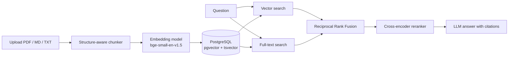

# RAG Starter

[](https://github.com/arkhan0072-dev/rag-starter/actions/workflows/ci.yml)

A production-style retrieval-augmented generation (RAG) API: upload documents, ask questions, get answers with citations. Built with FastAPI and PostgreSQL + pgvector, with an evaluation harness that measures how much each part of the pipeline actually helps.

Runs fully locally: embeddings and the reranker are small ONNX models, and the LLM step is optional (Anthropic or OpenAI).

## Features

- **Upload PDF, Markdown or text** and query it over a REST API (`/documents`, `/query`).
- **Structure-aware chunking**: splits on headings, keeps whole paragraphs together and stores the heading path (e.g. `Returns > Damaged goods`) with every chunk.
- **Hybrid retrieval**: pgvector cosine search plus PostgreSQL full-text search, merged with Reciprocal Rank Fusion.
- **Cross-encoder reranking** of the fused candidates.
- **Answers with citations** from Anthropic or OpenAI, or an extractive answer when no API key is set.
- **Collections** to keep separate document sets in one database; re-uploading a file replaces it.
- **Evaluation harness** with a fixed question set, reporting Hit@1, Hit@5 and MRR for each pipeline variant.
- **Tests and CI**: unit tests, an end-to-end API test against real PostgreSQL, lint, and the evaluation on every push.

## Architecture



## Evaluation

`eval/` contains a small sample knowledge base for a fictional logistics company (4 policy documents) and 30 questions phrased the way people actually ask them ("How many holiday days do I get?" when the document says "annual leave"). A question counts as answered at rank *r* when the *r*-th retrieved chunk comes from the right document and contains the expected answer.

Questions: 30, documents: 4, top_k: 5

| Pipeline | Hit@1 | Hit@5 | MRR |
|---|---|---|---|
| Fixed-size chunks, vector search (baseline) | 83% | 100% | 0.91 |
| Structure-aware chunks, vector search | 93% | 100% | 0.96 |
| Structure-aware chunks, hybrid search (RRF) | 83% | 100% | 0.91 |
| Structure-aware chunks, hybrid + reranker | **97%** | 100% | **0.98** |

What the numbers show:

- **Structure-aware chunking** gave the biggest single gain (83% → 93% Hit@1). Fixed-size chunks cut answers in half and mix unrelated sections.
- **Hybrid search alone lowered Hit@1** on this set. The questions are paraphrased, so keyword matches pull in passages that share words but not meaning, and fusion pushes them up. Hybrid search pays off on exact terms such as order IDs, error codes and product names, which this question set does not cover.
- **The reranker** fixes the ordering of the fused candidates and gives the best result (97% Hit@1, MRR 0.98). It is the default mode.
- Hit@5 is 100% for every variant because the corpus is small. A larger, harder question set is the next step.

Run it yourself with `python -m eval.run_eval` (results are written to `eval/results.md`, and CI adds them to each run's summary).

## Quick start

Requirements: Docker.

```bash
cp .env.example .env
docker compose up --build
```

The API runs at http://localhost:8000 (interactive docs at `/docs`). The first request downloads the embedding and reranker models (about 100 MB) into a Docker volume.

Upload a document and ask a question:

```bash
curl -F "file=@eval/corpus/shipping-policy.md" http://localhost:8000/documents

curl -X POST http://localhost:8000/query \
  -H "Content-Type: application/json" \
  -d '{"question": "Can I ship perfume by plane?", "top_k": 2}'
```

Response (shortened; without an LLM key the answer is the best passage):

```json
{
  "answer": "Lithium batteries can only be shipped when installed in the device they power. Loose lithium batteries are refused at collection.\n\nPerfume, aerosols and other flammable goods require a dangerous-goods declaration and can only travel by road, never by air. ...",
  "citations": [
    {
      "source": "shipping-policy.md",
      "heading": "Northwind Freight Shipping Policy > Restricted items",
      "snippet": "Lithium batteries can only be shipped when installed in the device they power. ...",
      "score": 3.14
    },
    {
      "source": "shipping-policy.md",
      "heading": "Northwind Freight Shipping Policy > Weight and size limits",
      "snippet": "A single parcel may weigh up to 30 kg. ...",
      "score": -11.1
    }
  ]
}
```

In `hybrid_rerank` mode the score is the reranker's relevance score, so the gap between the first and second result shows how confident the ranking is.

To generate written answers with an LLM, set `LLM_PROVIDER=anthropic` (or `openai`), `LLM_MODEL` and the matching API key in `.env`. The model is instructed to answer only from the numbered sources and cite them.

### API

| Method | Path | Body | Description |
|---|---|---|---|
| `POST` | `/documents` | multipart: `file`, optional `collection` | Chunk, embed and store a document (PDF, MD, TXT, max 10 MB). Re-uploading a file replaces it. |
| `POST` | `/query` | `question`, `top_k` (1-20), `mode` (`vector`, `hybrid`, `hybrid_rerank`), `collection` | Retrieve passages and answer with citations. |
| `GET` | `/health` | | Database check. |

## Development

Run the tests and lint inside the container (the end-to-end test uses the Compose database):

```bash
docker compose up -d db
docker compose run --rm api sh -c "ruff check . && pytest -q"
docker compose run --rm api python -m eval.run_eval
```

Or locally with Python 3.11+: `pip install -e ".[dev]"` and set `DATABASE_URL`.

## Design decisions

- **PostgreSQL for everything.** Vectors (pgvector, HNSW index), full-text search (`tsvector`, GIN index) and metadata live in one database, so there is no separate vector store to keep in sync and a document's chunks are replaced in one transaction.
- **Rank fusion instead of score blending.** Cosine similarity and `ts_rank` are on different scales, so RRF combines the two result lists by position only.
- **OR-ed full-text queries.** `plainto_tsquery` joins words with AND, which almost never matches a whole question, so the terms are OR-ed and ranking is left to `ts_rank_cd`.
- **Filtered vector search.** HNSW returns a fixed number of candidates before the `WHERE collection = ...` filter runs, which can return too few or misordered rows when several collections share the table. Connections enable pgvector's iterative index scans (`hnsw.iterative_scan = strict_order`) to avoid that.
- **Deterministic ranking.** Ties are broken by chunk id in both searches and in fusion, so evaluation results are reproducible run to run.
- **Local models by default.** `bge-small-en-v1.5` (embeddings) and `ms-marco-MiniLM-L-6-v2` (reranker) run on CPU through ONNX, so the project works without any API key.

## Project structure

```
app/
  main.py        FastAPI app and endpoints
  chunking.py    fixed-size and structure-aware chunkers
  ingest.py      text extraction, chunking, embedding, storage
  retrieval.py   vector, full-text, fusion and reranked search
  models.py      embedding and reranker models
  llm.py         prompt and answer generation (Anthropic / OpenAI / none)
  db.py          schema and connection pool
  config.py      settings from environment
eval/
  corpus/        sample documents (fictional company)
  questions.jsonl
  run_eval.py
tests/
```

## License

MIT
